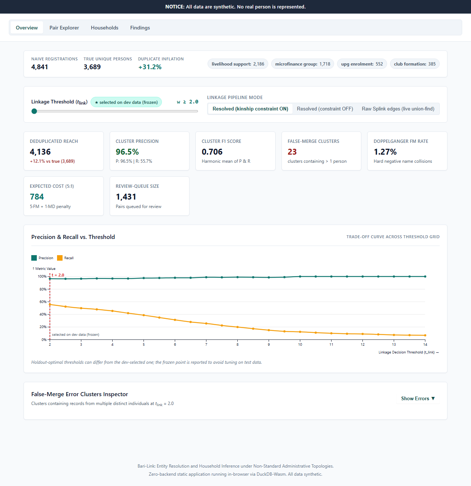
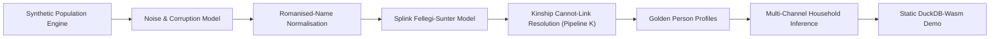

# Bari-Link: Kinship-Constrained Entity Resolution

[](https://github.com/tahmidshafi/bari-link/actions/workflows/ci.yml)
[](https://github.com/tahmidshafi/bari-link/actions/workflows/pages.yml)

Kinship-aware probabilistic deduplication and household inference for multi-module NGO beneficiary registries that share no identifier, evaluated on a synthetic population modelled on rural Bangladesh.

> **All data in this repository and the demo are synthetic. No real person is represented.**

**Live Interactive Demo:** [https://tahmidshafi.github.io/bari-link/](https://tahmidshafi.github.io/bari-link/)



---

## The Problem

NGO programmes often enrol the same people through separate modules (here: adolescent clubs, ultra-poor graduation, microfinance groups and livelihood support) with no identifier shared across them. Bangla names are romanised inconsistently (Rahima / Rohima), a woman may be recorded with her father's name in one register and her husband's in another, and phones are often shared within a household. Unlinked duplicates inflate reported reach; wrong merges can deny a person a transfer. This project measures both errors explicitly, under an assumed cost of 5:1 for a false merge versus a missed duplicate.

---

## What This Project Does

Bari-Link evaluates record linkage under an asymmetric operational cost (5:1 for false merge vs. missed duplicate) and incorporates deterministic kinship cannot-link constraints alongside Fellegi-Sunter log-odds models to jointly resolve individuals and infer households.



---

## Key Results

<!-- results:start -->
### Person Resolution Performance (Holdout Seeds 5–9, 5:1 Cost Ratio)

| Model / Pipeline | Operational Cost (5:1) | Cluster-Level Precision | Cluster-Level Recall | Cluster-Level F1 | Doppelgänger FM Rate |
| :--- | :---: | :---: | :---: | :---: | :---: |
| **Deterministic Baseline** (Exact Name/Phone) | 1398.4 ± 42.2 | 0.8535 ± 0.0395 | 0.1775 ± 0.0155 | 0.2936 ± 0.0219 | 0.0553 |
| **Reference Splink v3.1** (Resolved) | 888.2 ± 51.2 | 0.9457 ± 0.0127 | 0.5334 ± 0.0202 | 0.6819 ± 0.0174 | 0.0158 |
| **Champion Pipeline K** (Resolved + Kinship Constraint) | **812.2 ± 29.2** | **0.9656 ± 0.0106** | 0.5277 ± 0.0172 | **0.6823 ± 0.0137** | 0.0132 |

> **Confirmation Verdict:** CONFIRMED — 5/5 seeds; one-sided sign test p = 0.031 (two-sided 0.0625) (paired cost delta: -76.0 ± 27.3, -8.56% relative reduction).

### Cost-Ratio Sensitivity Analysis

| Cost Ratio (FP:FN) | Operating Label | Reference Cost | Pipeline K Cost | Paired Δ Cost (K - Ref) | Seeds Won | Sensitivity Verdict |
| :---: | :--- | :---: | :---: | :---: | :---: | :--- |
| 1:1 | Balanced | 713.0 ± 34.7 | 704.2 ± 26.6 | -8.8 ± 11.8 | 3/5 seeds | No clear difference (3/5 seeds) |
| 2:1 | 2:1 | 756.8 ± 35.7 | 731.2 ± 23.1 | -25.6 ± 13.6 | 5/5 seeds | K better (5/5 seeds) |
| 5:1 | Pre-Registered (5:1) | 888.2 ± 51.2 | 812.2 ± 29.2 | -76.0 ± 27.3 | 5/5 seeds | K better (5/5 seeds) |
| 10:1 | Heavy FP Penalty (10:1) | 1107.2 ± 93.0 | 947.2 ± 64.5 | -160.0 ± 55.5 | 5/5 seeds | K better (5/5 seeds) |

> **Sensitivity Summary:** K is preferred when false merges cost at least 2x missed duplicates.

### Household Entity Resolution & Oracle Comparison (Holdout Seeds 5–9, t_hh = 5.0)

| Pipeline Configuration | Record Pairwise F1 | Precision | Recall | Unit B-cubed F1 | Size MAE | Reach Error % |
| :--- | :---: | :---: | :---: | :---: | :---: | :---: |
| **Champion Pipeline K + Household** | 0.4601 ± 0.0063 | 0.6886 ± 0.0166 | 0.3455 ± 0.0042 | 0.7528 ± 0.0018 | 2.06 ± 0.07 | 59.1% ± 1.1% |
| **Oracle Persons + Household** | 0.6066 ± 0.0116 | 0.7155 ± 0.0222 | 0.5265 ± 0.0068 | 0.8103 ± 0.0043 | 2.01 ± 0.08 | 38.7% ± 0.9% |
| **Drop E2 (Husband Link)** | 0.4760 ± 0.0077 | 0.9332 ± 0.0152 | 0.3195 ± 0.0066 | 0.7556 ± 0.0028 | 1.70 ± 0.04 | 66.6% ± 0.9% |
| **Halved Weights (0.5x)** | 0.3069 | — | — | — | 1.70 | — |
| **Doubled Weights (2.0x)** | 0.2129 | — | — | — | 7.21 | — |

> **Error Attribution:** Most household error is intrinsic to household inference (Oracle reaches F1 0.61). Inherited person-linkage error accounts for about 0.15 F1, predominantly lost recall.

### Pre-Registered Hypotheses & Provenance

| Pre-Registration / Hypothesis | Pre-Reg Commit | Pre-Reg Date | Outcome Commit | Precedes Outcome? | Verdict |
| :--- | :---: | :---: | :---: | :---: | :---: |
| **H1: Guardian Type Disambiguation** | `135d7f2` | 2026-11-07 | `b40ef4f` | Yes | SUPPORTED (Dev) |
| **H2: Kinship Disambiguation (v3)** | `2477c5c` | 2026-11-07 | `b40ef4f` | Yes | SUPPORTED (Dev) |
| **H3: Kinship as Constraint (Pipeline K)** | `3a22c32` | 2026-11-07 | `1ec10a4` | Yes | CONFIRMED (Holdout) |

### Untrained Splink Parameters Sensitivity Audit

> **Audit Summary:** The champion pipeline's operational cost and cluster metrics are insensitive to setting the untrained levels to neutral (Bayes factor 1). Setting untrained levels to neutral Bayes factor 1.0 shifts 5-seed mean cost by -0.6 cost points (from 812.2 to 811.6) and shifts F1 by -0.0002.
> `sex_raw`: not estimated; every candidate pair is null; inert; recommended for removal (230,640 null candidate pairs).
<!-- results:end -->

---

## What I Learned (Including What Failed)

1. **A leak inflated my first results slightly.** The generator filled fields (guardian type, sex) that the module forms never collect, so the model saw ground truth. A schema audit found it; after the fix, `splink_v1` on clean rebuilds of `holdout_0..4` moved slightly in cluster precision (`0.9404 → 0.9243`) and recall (`0.4741 → 0.4408`). An earlier figure of `0.61` (`0.6068`) came from holdout outputs that a clean rebuild could not reproduce, and it was corrected after a fresh-clone reproducibility check.
2. **Kinship works better as a rule than as evidence, with a trade-off.** Roster overlap signals "same household", not "same person", which breaks the Fellegi-Sunter independence assumption. Using it only as a cannot-link rule (Pipeline K) lowered cost against the probabilistic-kinship reference on 5/5 fresh seeds (mean -76.0 points; one-sided sign test p = 0.031), but only when false merges cost at least 2x missed duplicates (tie at 1:1). In a namesake stress test (`stress_0`, `--seed-offset 0`) at matched recall 0.50, K let through more cross-household namesakes (55.6% vs 49.0%).
3. **Pre-registration constrained me.** Hypotheses were committed before their results (table above). H3 was suggested by earlier holdout results, so it was confirmed only on five new seeds.
4. **An early negative result was an artefact.** Weak-bridge splitting first looked useless; after the leak was fixed it was selected on dev data (t_bridge 4.0 above t_link 2.0).
5. **Household inference is the weakest part.** Record-level F1 is 0.46 with a-priori evidence weights; halving or doubling the weights drops it to 0.31 or 0.21, and even perfect person linkage only reaches 0.61. Dropping the husband-name link raises precision from 0.69 to 0.93, indicating that matching husbands by name skeleton creates false household merges.
6. **Bugs the verification gates caught:** non-deterministic household cuts (first: `cannot-household` worklist order; second: tied min-cuts at 2.0x weights from `PYTHONHASHSEED`-dependent subgraph edge iteration order in `infer.py`, fixed in commit `897b32e` with the regression test added in the follow-up commit), waterfall labels shown for the wrong match level (looked up by list position instead of Splink's comparison-vector value; the weights themselves were correct), a publish step that silently overwrote confirmed results, and summary numbers an AI agent reported without computing them.

---

## Limitations

- Synthetic data only; not validated on any real registry.
- Corruption, phone-sharing and guardian-switch rates are assumptions (configs/default.yaml), not calibrated to real data.
- The 5:1 cost ratio is an assumption. K beats the probabilistic-kinship reference only at >= 2:1.
- Recall is modest (0.53): about half of true duplicate pairs stay unlinked at the chosen operating point.
- K's selected link threshold lies on the lower edge of the tested grid; it was not re-tuned, to protect the confirmation.
- Some Splink levels use default parameters (phone last-8, village); setting them to neutral changes mean cost by -0.6 points.
- Household inference uses a-priori weights and is fragile; 34.5% of households have no roster, so indirect reach cannot be estimated for them.
- No module records sex; the sex comparison is inert.
- Splink is pinned to 4.x.

---

## How This Was Built

Implementation was written by an AI coding agent (Antigravity IDE); planning, design suggestions and review used a second AI assistant (Claude). I set the scope, chose between options, committed the pre-registrations, ran every step and checked results against the raw outputs, and accepted only work that passed automated gates: a fresh-clone CI proof, regression tests against pre-registered reference values, a determinism test across hash seeds, and a README render check. Those gates caught several AI-introduced errors (item 6 above).

---

## Reproduce

```bash
# Environment setup (Python 3.14; lock requires >=3.12)
python -m venv .venv && source .venv/bin/activate  # Windows: .venv\Scripts\activate
pip install -r requirements-lock.txt
pip install -e . --no-deps

# Re-run full multi-seed experiment sweep from scratch
python scripts/reproduce_all.py

# Provenance generation & documentation check
python scripts/generate_preregistration_json.py
python scripts/render_readme.py --check
python scripts/check_links.py

# Run full pipeline to generate and resolve publish dataset
python -m barilink.cli pipeline --profile publish

# Verify pipeline output against committed headline metrics
python -m barilink.cli pipeline --verify

# Run test suites
pytest -q -m "not publish and not artifacts"  # CI unit & determinism tests
pytest -q -m artifacts                        # Golden metric & leakage gates
pytest -q -m publish                          # Full dataset verification

# Static web app build & test
cd web && npm ci && npm test && npm run build && npx playwright test
```

The artifacts tests need the full local experiment runs (dev, holdout and stress seeds), which `python scripts/reproduce_all.py` generates; see [docs/METHODS.md > Reproducing the experiments](docs/METHODS.md#8-reproducing-the-experiments).

---

## Change Log

- **2026-11-15 — Household `2.0x` determinism fix (`897b32e` + follow-up test):** Sorted subgraph edges before `nx.stoer_wagner` / `nx.minimum_cut` in `src/barilink/household/infer.py` and set intersections in `evidence_lineage` in `src/barilink/household/evidence.py`, eliminating `PYTHONHASHSEED`-dependent tie-breaking; added a 30-node tied-min-cut regression test in `tests/test_pipeline_determinism.py`.
- **2026-11-15 — Clean re-baseline via `scripts/reproduce_all.py`:** Regenerated all `demo`, `holdout_0..9`, `stress_0`, and summary JSONs from one script in one locked environment:
  - `leakage_comparison.json` (`splink_v1_post_fix` precision `0.6068 → 0.9243`, recall `0.7564 → 0.4408`; `splink_v1_resolved_post_fix` precision `0.6303 → 0.9188`, recall `0.7615 → 0.4500`): replaced non-reproducible earlier `holdout_0..4` outputs with clean `demo`-trained rebuilds.
  - `confirm_table.json` (`stress_0` at `--seed-offset 0`, recall `0.50`: Pipeline K `0.621 → 0.556`, Reference `0.523 → 0.490`, gap `9.8 → 6.6` pp): updated from explicit `--seed-offset 0` run.
  - `h2_dev_outcome.json` (`splink_v3` dev cost `875.0 → 876.0`, recall `0.4733 → 0.4726`, F1 `0.6350 → 0.6343`): updated from clean `demo` rebuild and `--threads 1` retrain.
  - `household_table.json` (`doubled_2_0x` F1 `0.2127 → 0.2129`, Size MAE `7.2555 → 7.2092`): deterministic output after the `infer.py` tie-breaking fix; all other household, H3, Reference, Pipeline K, cost-ratio, and baseline numbers are unchanged.
  - `tests/test_summary_artifacts.py`: updated `h2_dev_outcome` reference `875.0 → 876.0` and `doubled_2_0x` reference `0.2055 / 7.40 → 0.2129 / 7.21` with tightened tolerances (`abs=0.0005` and `abs=0.01`).
- **2026-11-15 — Environment lock (`requirements-lock.txt`):** Pinned all 29 dependencies from Python 3.14.6; updated `pyproject.toml` (`requires-python = ">=3.12"`) and CI/Pages workflows to Python `3.14`.
- **2026-11-15 — Run provenance & `METHODS.md` Section 8:** Added deterministic `results/<run>/provenance.json` (git commit, dirty flag, platform, CLI args, `seed_offset`, config SHA-256, Python/package versions; no timestamps) and replaced `docs/METHODS.md` Section 8 with a pointer to `scripts/reproduce_all.py` and corrected manual commands.

---

## Repository Map

```
├── configs/             # Pipeline & data generation configurations
├── docs/                # Detailed methodology (METHODS.md), audits, screenshots
├── results/             # Committed evaluation summaries, models, and headline benchmarks
├── scripts/             # Reproducibility scripts (render_readme.py, check_links.py)
├── src/barilink/        # Core Python package (generation, linkage, household, eval)
├── tests/               # Pytest suite (determinism, leakage, regression, pipelines)
└── web/                 # Static DuckDB-Wasm application (React, TypeScript, Vite)
```

---

## References

- Fellegi, I. P., & Sunter, A. B. (1969). A Theory for Record Linkage. *Journal of the American Statistical Association*, 64(328), 1183–1210.
- Linacre, R. et al. (2022). Splink: Free software for probabilistic record linkage at scale. *International Journal of Population Data Science*.
- Bagga, A., & Baldwin, B. (1998). Algorithms for Scoring Coreference Chains. *The First International Conference on Language Resources and Evaluation Workshop on Linguistics Coreference*.
- Additional methodology and design rationale: see [docs/METHODS.md](docs/METHODS.md) and [PROJECT_CONTEXT.md](PROJECT_CONTEXT.md).
